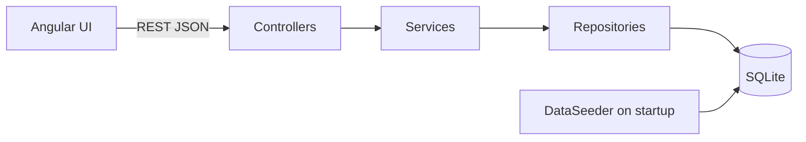

# Design

## Architecture

Layers: thin controllers -> services (rules) -> repositories. DTOs (records) are separate from the entity,
and validation lives on the request DTO.

## Data model
`employee(id, full_name, email UNIQUE, job_title, department, country, currency,
annual_salary, annual_salary_usd, hire_date)`

- Money is a whole-number `long`, never floating point.
- `annual_salary_usd` is computed when the employee is written, so SQL can aggregate across countries.
- Dates are stored as ISO text via an attribute converter, to avoid SQLite JDBC's date-as-milliseconds behaviour.
- Indexes: country, department, job_title, annual_salary_usd.

## API
| Method | Path | Purpose |
|---|---|---|
| GET | /api/employees?search&country&department&jobTitle&page&size&sort | paged, filtered list |
| GET | /api/employees/filters | distinct values for filter dropdowns |
| GET/POST/PUT/DELETE | /api/employees[/{id}] | CRUD |
| GET | /api/insights/summary | org-wide stats in USD |
| GET | /api/insights/by/{country\|department\|job-title} | stats per group in USD |
| GET | /api/insights/earners?order=desc&limit=10 | top / bottom earners |

Errors share one JSON shape: `{ "status": 400, "error": "..." }`.
